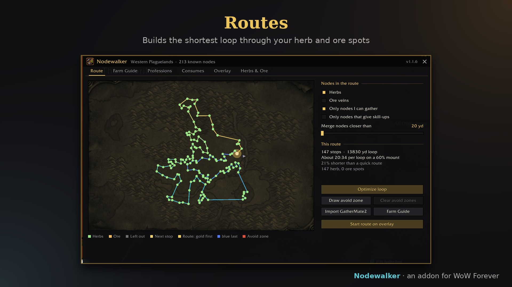
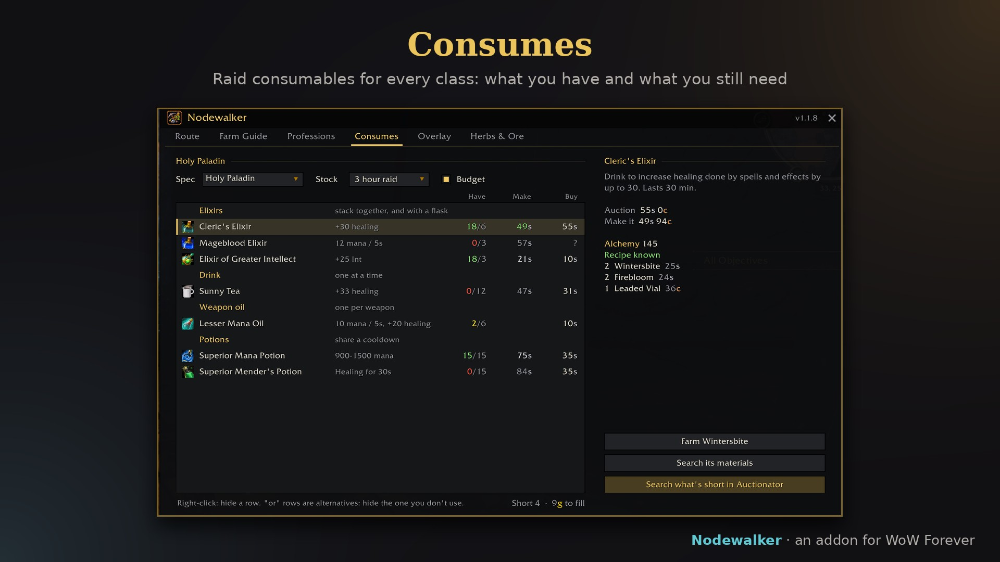

# Farm smarter. Craft cheaper. Earn more.

**Nodewalker is a profession and gathering companion for WoW Forever.**

Follow a short gathering route on a see-through map over the game world. Level any profession the cheapest way at today's auction prices. See which recipes you're missing and where they come from, and which crafts are worth a look. Nothing to alt-tab for.

Leveling a profession, getting ready for raid night, or out picking herbs and ore for the evening: Nodewalker helps you decide what to do next.

## Gathering GPS

- A Diablo-style map in the middle of your screen, see-through and click-through
- Herb and ore spots with the game's own icons
- Your minimap's own herb and ore dots, live, over **known spots** (faded): where a node has spawned before, not a promise one is there now
- Your route in cyan: brightest near you, with direction arrows
- A compass bar with the route's stops ahead of you
- A ring showing your minimap's range, where live nodes can show up
- Gathered spots turn grey until they can respawn
- Session panel: time, nodes gathered, loops, and their value at Auctionator prices
- Presets: **Farming**, **Questing**, **Minimal**
- Fades while you move; can hide in combat and in cities

## Routes

- A short loop with every known spot in sight along the way
- Built for you when you enter a zone; **Optimize loop** rebuilds it
- Draw avoid zones on a large, fully explored map, and the route goes around them

## Material Finder

- Search every material: herbs, ore, leather, fish, cloth, meat, reagents, vendor goods, crafted parts
- Where to get it: best zones for herbs and ore, hunting grounds for skins and creature drops, fishing waters, vendors, recipes
- A map of each zone: known spots, your own gathering, heatmap, route
- Targets: track how many you want; the session panel counts them
- One click opens a herb, ore or hunting route in the Route tab to review and start
- **Both** view for Herbalism and Mining together

Loop times and gold per hour are worked out from known spots and current prices. What you actually gather depends on spawns and other players.

## Profession Leveling

- A plan from 1 to 300 for every profession, chosen once at today's prices and kept as you level (**Re-plan** to choose again)
- Choose a strategy: **Cheapest**, **Fewest crafts**, or **Known recipes**
- Steps grouped by rank, with each trainer one click from your map
- Crafts per step, from each recipe's skill-up chance
- Parts you make first (bolts, blasting powder) and the tools you need (Blacksmith Hammer, Arclight Spanner, enchanting rods) get their own rows
- One shopping list: recipes to buy, materials and vendor supplies, minus what's in your bags
- Estimated total cost, with resale value beside it
- One click to search Auctionator for what's missing; craft straight from the plan

Costs and craft counts are estimates: prices move and skill-ups are random.

## Missing Recipes

- The recipes you don't know yet, and where each comes from
- Filter by source: trainer, Merchant's Favor, vendor, drop
- Your faction's trainers and vendors, shown on your map
- Recipes with many drop sources read "World Drop or AH"

## Profit

- What each recipe's materials cost and what the result lists for, after the auction cut
- Sort by profit, return, cheapest materials, or how many your bags can make now
- Click a recipe for its materials and what each costs
- Counts disenchant value for gear

Listing prices aren't sales. Profit here means worth a look, not guaranteed gold.

## Smart Fishing

- **One key:** puts your fishing gear on, then your lure, then casts. While the bobber is out the same key reels in through the game's Interact Key. Every action is your key press
- **Gear:** save your pole, hat, gloves and boots as a set; one button swaps between fishing gear and your normal gear
- **Lures:** your preferred lure or the strongest you carry, never replaced while one is on; alerts when it's running out
- **HUD:** skill, lure time, fish caught, estimated value, what the key does next, and the fish your Fishing + Cooking plan wants
- **Quiet while fishing:** music and ambience off, sound effects up for the splash; your volumes come back after
- **Fishing Journal:** every catch recorded automatically: by fish, by zone with your own catch spots on the map, and by session. Only loot the game marks as fishing counts

## Fishing and Cooking

- **Cooking** levels like any craft, from any ingredients: meat, fish, vendor goods, your bags. Or only fish recipes, or none
- **Fishing** has its own guide: where to fish at each skill, what's caught there, when to train, your effective skill with gear and lures
- **Fish** in the Material Finder: every fish, where it's caught, and what it cooks
- **Fishing + Cooking**: one plan for both from the fish you catch. What to fish, how many of each fish (estimated), when to train, what to cook, as it happens

Zone fishing skill and catch rates aren't published for WoW Forever, so Nodewalker doesn't guess them. Zone shares in the Journal are your own catches, not drop rates.

## Consumes

- Consumables for every class and spec
- **My level**: the best you can use, and get, while leveling
- Stock for a 2, 3 or 4 hour raid: what you have against what you need
- Craft or buy, side by side, with the materials needed
- One Auctionator search for everything you're short of
- Saved per character

## Find a Craft

- Any recipe in any profession, to have someone make it
- What the materials cost, what's left after your bags, and the auction price ready-made

## Also

- Gathering and Fishing guides by skill range
- A Nodewalker button on your profession window
- Minimap and AddOns menu button, key bindings (Smart Fishing, fishing HUD, Fishing Journal too)
- Every overlay setting: size, opacity, terrain, markers, ring, compass, session panel

## Quick start

**Start gathering:** `/nw guide` › pick an herb or ore › click a zone › **Build route** › **Start** in the Route tab › go there and type `/nw` › follow the cyan line.

**Level a profession:** `/nw prof` › pick a profession › **Leveling** › set your target skill › buy what's on the list (**Search missing**) › follow the steps.

**Fish:** bind **Smart Fishing** in Key Bindings › AddOns (or Settings › Fishing) › press it to equip, lure and cast › press it again on the splash.

**Find crafts worth making:** `/nw prof` › pick a profession › **Profit** › sort by profit › click a recipe for its materials.

## Requirements

- **Required:** nothing else. Nodewalker works on its own.
- **Recommended: Auctionator.** Auction prices for leveling costs, profit, consumes, the Material Finder and the session panel, and the Search buttons. Without it, vendor items keep their vendor price and the rest show as estimates (~) or "No price".
- **Optional: GatherMate2 + GatherMate2_Data.** A one-time import of thousands of known spots (`/nw import`). Without it, Nodewalker learns spots as you gather and as they show on your minimap. You can turn GatherMate2 off after the import.

Prices come from Auctionator's last scan, so scan the auction house now and then.

## FAQ

**Does it gather or move for me?** No. It shows where to go; you walk, gather, buy and craft.

**Does Smart Fishing fish for me?** No. Each press does one thing: equip, lure, cast, or reel in when you see the splash. The game gives addons no bite signal, so nothing is automatic.

**Are the spots guaranteed to have a node?** No. Faded spots are where nodes have spawned before. Your minimap's dots on the overlay show what's really up.

**Do I need a gathering profession?** Only for the overlay, routes and Material Finder herb and ore zones. Leveling, Profit, Consumes and Find a Craft work for everyone.

**Why do some items say "No price"?** Auctionator hasn't seen them listed. Scan the auction house and they fill in.

**How do I change a route?** Open the Route tab: **Optimize loop** to rebuild it, or draw avoid zones and it goes around them.

**Which game versions?** WoW Forever.

**Found a bug?** [Report it on GitHub](https://github.com/Vx1125/Nodewalker/issues) with what you did and any error text.

## Commands

`/nw` overlay · `/nw plan` routes · `/nw guide` Material Finder · `/nw prof` professions · `/nw consumes` · `/nw journal` Fishing Journal · `/nw fishhud` · `/nw options` · `/nw import` GatherMate2 · `/nw status` · `/nw reset session`

## Credits

Minimap tiles and map reveal data: [OpenMap](https://github.com/openmap-world/openmap) (MIT). Recipe data: SeeMeta and One For All by Smoergi (GPL-3.0-or-later). Consumable lists follow Method's and Wowhead's WoW Forever guides.

GPL-3.0-or-later.
