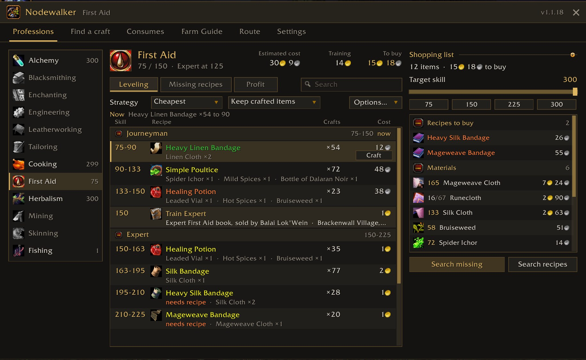
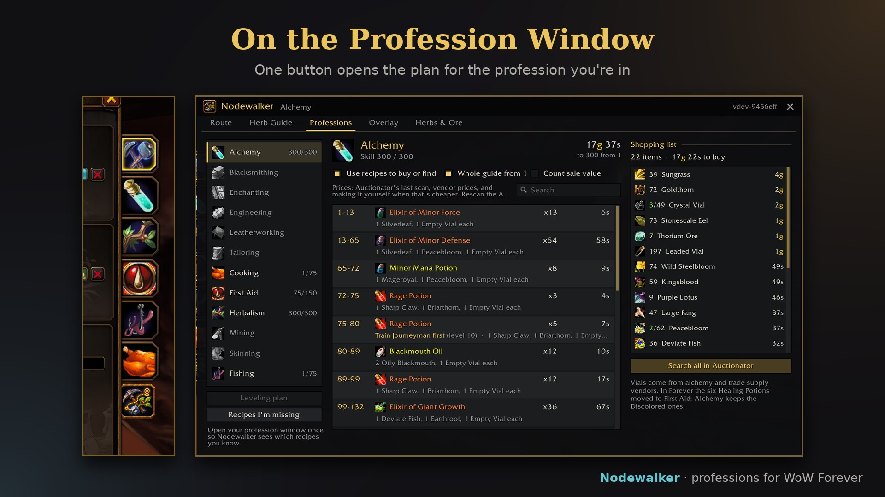

**Gathering and professions for WoW Forever, in one addon.** A Diablo-style farming map, optimized herb and ore routes, a leveling guide for every profession, and raid consumable lists for every class, priced from the auction house.

Nodewalker replaces GatherMate2 + Routes + FarmHud for farming, and adds a profession guide on top. It **imports your GatherMate2 nodes** for routes, and **reads Auctionator's prices** so every leveling plan costs what the auction house charges today.

## Farming overlay

- A map in the middle of your screen, like Diablo II or Path of Exile. The real minimap terrain scrolls under you, caves and underground cities included.
- Live herb and ore dots from your minimap, with a ring showing how far they reach.
- Herb and ore icons for every known spot: faded until one is seen up, bright when it is.
- Clicks pass through to the world. Alt + hover a dot to see what it is.
- Only shows what your professions can gather. Hide any herb or ore you don't farm.
- Fades while moving; hides in combat, cities and dungeons.
- Zone banner as you arrive: known spots and your route.
- Nearby spots share one icon with a count. Minimap button, and one-click Farming, Questing and Minimal looks.

## Routes

- **Imports GatherMate2**, including its data pack, so you start with thousands of known spots. Turn GatherMate2 off afterwards if you like.
- Builds the shortest loop through every node your filters allow, then follows it stop by stop.
- Draw avoid zones on the map to stay clear of elites and camps.
- New spots you find join the route where they add the least distance.
- Enter a zone with no route and one is built for you.
- Picked stops are skipped until they've had time to respawn.
- Session panel: loops, loop time, nodes and gold per hour.

## Farm Guide

- The best zones for every herb and every ore, with where to look in each zone.
- Ranked by spots per minute on a loop, from your own node data, with gold per hour at today's prices.
- **Both**: for Herbalism + Mining, zones ranked by what a loop through everything you can gather is worth.
- Preview the loop on the map, then build a route through just that herb or ore, picking up the rest on the way if you like.

## Professions

- A leveling plan for every profession, from your skill to 300: Alchemy, Blacksmithing, Enchanting, Engineering, Leatherworking, Tailoring, Cooking and First Aid.
- **Priced with Auctionator.** For each skill point it picks the cheapest recipe at today's prices, counting the chance of a skill-up as recipes turn yellow and green.
- Vendor prices are learned at merchants. Bolts, bars and parts you can make yourself are priced that way when it's cheaper.
- Uses WoW Forever's own recipes and skill-up colours, including the new ones.
- **Train rows** show where to learn Expert and Artisan; click one to pin the trainer on your map.
- **Level to** slider: stop the plan at any skill.
- Counts trainer fees and adds a few spare crafts per step.
- **Shopping list** of everything left to buy, recipes included, minus what's in your bags and bank. Click an item, or one button for the whole list, to search Auctionator for what you still need.
- **Profit**: what each craft earns at today's prices, sold or disenchanted, best first. Click one for its materials; click a material to see how to make it.
- **Crafts: Keep, Sell or Disenchant**: plan your leveling around what you'll do with the items.
- **Recipes**: every recipe in the game and where it comes from (trainer, vendors, drops, quests, Merchant's Favor). Shows what you're missing; search by recipe, material, mob or zone to find anything.

## Consumes

- Raid consumables for every class and spec: flasks, elixirs, food, weapon buffs and potions, with a Budget list of cheaper tiers.
- **Stock** for a 2, 3 or 4 hour raid: how many you have against how many you need.
- **Make or Buy**: what each costs to craft if you have the profession, whether you know the recipe, and where to get it if you don't.
- One button searches Auctionator for everything you're short of: materials for what you'd make, the item for the rest.
- Farm a consumable's herbs from the Farm Guide in one click. Right-click a row to hide what you don't use.

### Gathering and Fishing

- Where to go at every skill range for Herbalism, Mining, Skinning and Fishing.
- Click a skill range to open the Farm Guide on the best herb or ore for it.
- Fishing + Cooking: what to catch at your skill, and which recipes cook it.

### On the profession window

- A Nodewalker button under your professions opens the plan for the one you're in.
- Your next step along the bottom: what to craft and how many.

## Settings

- Window size, opacity, zoom, map style and terrain colour.
- When the overlay shows, what's on screen, and which herbs and ore to include.

## Works with

- **GatherMate2** (optional): imports its nodes and data pack for routes and the Farm Guide.
- **Auctionator** (optional, recommended): live prices for leveling plans and the shopping list. Rescan the auction house to update.

Without them Nodewalker still records every node you gather, and prices plans from vendors and estimates.

## Commands

- `/nw` overlay on or off
- `/nw plan` route planner
- `/nw guide` Farm Guide
- `/nw prof` professions
- `/nw consumes` raid consumables
- `/nw options` settings
- `/nw import` import GatherMate2
- `/nw next` skip to the next stop
- `/nw hide <herb>`, `/nw show <herb>`

Key bindings under Options > Keybindings > AddOns > Nodewalker.

## Credits

Minimap tile data from [OpenMap](https://github.com/openmap-world/openmap) (MIT). Recipe data from SeeMeta's WoW Forever recipe database, the full recipe list, sources and trainer fees are derived from One For All by Smoergi (GPL-3.0-or-later). Consumable lists follow Method's and Wowhead's WoW Forever class guides.

## License

GPL-3.0-or-later.
