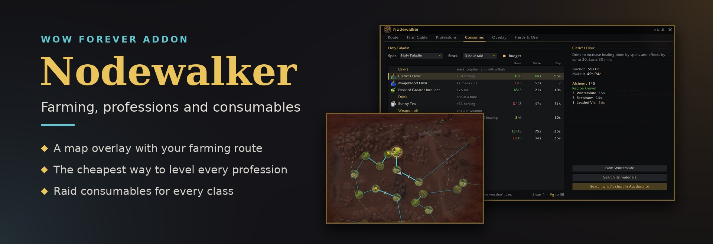
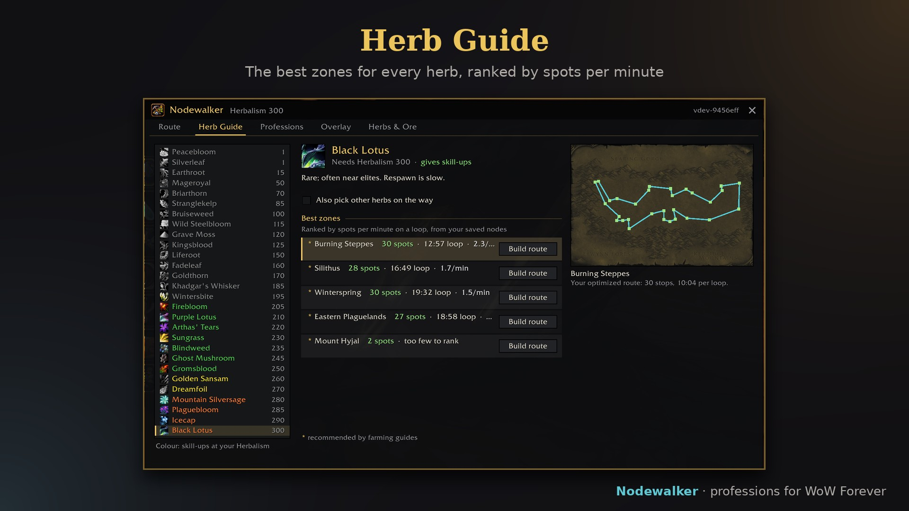
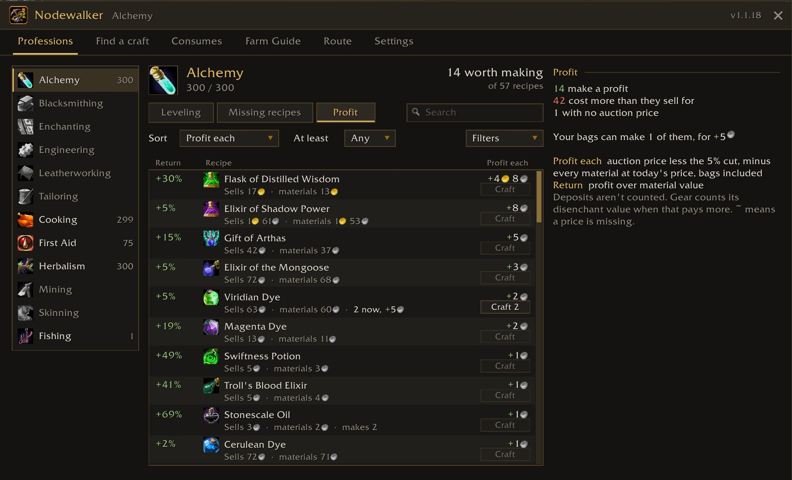
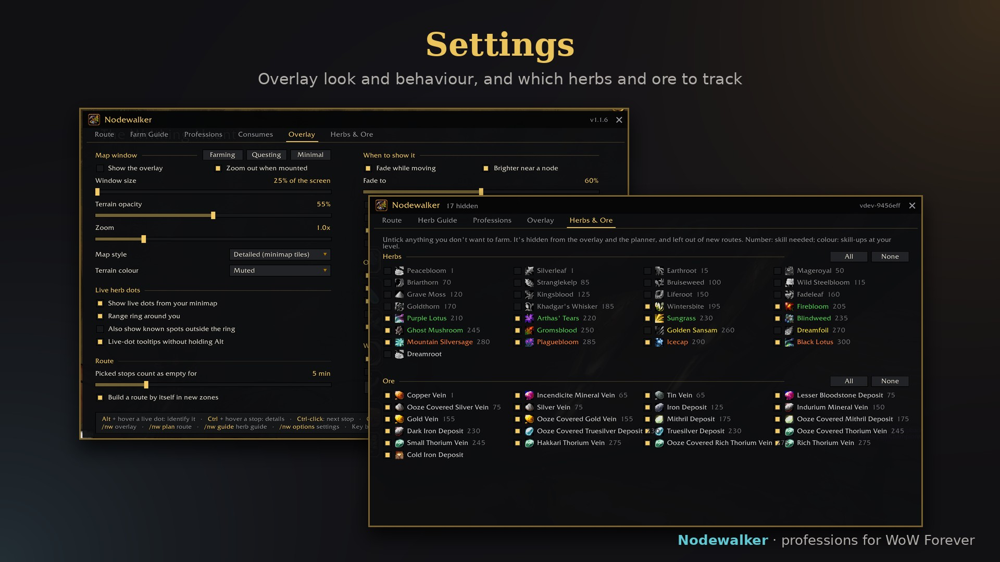

**Farming, professions and raid consumables for WoW Forever, in one addon.**

Imports your GatherMate2 nodes. Prices everything with Auctionator.

## Farming overlay

- A Diablo-style map in the middle of your screen
- Every known herb and ore spot, plus live dots from your minimap
- Click-through, fades while you move, hides in combat and cities

## Routes

- Builds the shortest loop through your nodes
- Follows it stop by stop and skips what you just picked
- Draw avoid zones around elites and camps

## Farm Guide

- Best zones for every herb and ore
- Ranked by spots per minute and gold per hour
- **Both** view for Herbalism + Mining

## Professions

- Cheapest way to 300 for every profession, at today's prices
- Shopping list with one-click Auctionator search
- Where to train each rank, pinned on your map
- Every recipe you're missing and where it comes from
- Craft straight from the plan

## Profit

- What every recipe earns right now, best first
- Click a recipe for its materials and what each costs
- Counts disenchant value for gear

## Consumes

- Raid consumables for every class and spec
- Stock for a 2, 3 or 4 hour raid: have against need
- Make or buy, whichever is cheaper
- One search for everything you're short of

## Also

- Gathering and Fishing guides by skill range
- A Nodewalker button on your profession window
- Minimap button, action bar button, key bindings
- Presets: Farming, Questing, Minimal

## Works with

- **GatherMate2** (optional): imports its nodes
- **Auctionator** (recommended): live prices

## Commands

`/nw` overlay · `/nw plan` routes · `/nw guide` Farm Guide · `/nw prof` professions · `/nw consumes` · `/nw options`

## Credits

Minimap tiles: [OpenMap](https://github.com/openmap-world/openmap) (MIT). Recipe data: SeeMeta and One For All by Smoergi (GPL-3.0-or-later). Consumable lists follow Method's and Wowhead's WoW Forever guides.

GPL-3.0-or-later.
