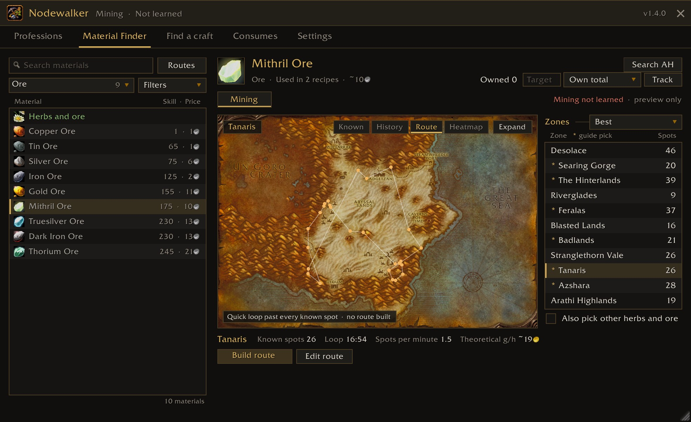
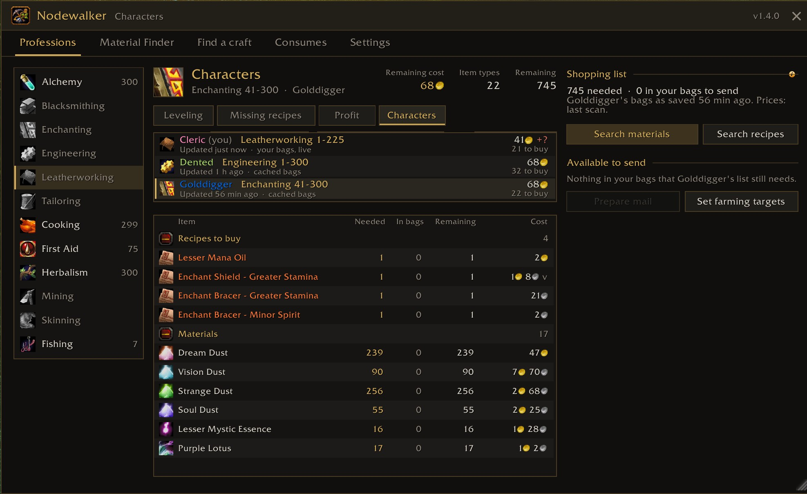
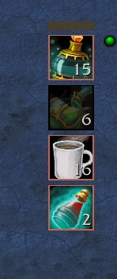
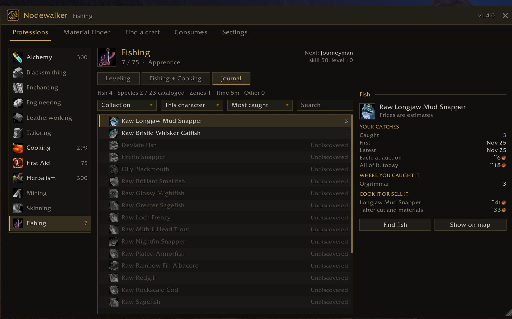

# Gather. Craft. Profit. Prepare.

**Your complete profession companion for WoW Forever.**

Nodewalker plans your professions, finds every material you need, shows you where to farm it on a see-through map, tells you which crafts are worth making, and keeps your consumables stocked. Each part feeds the next: a leveling plan becomes a shopping list, a shopping list becomes a farming route, and what one character needs becomes what another goes out to gather.

Plan on your crafting character, gather on your farming character, and send the materials where they're needed.

## Professions

Level any crafting profession from 1 to 300 at today's auction prices.

- A plan for your target skill, built once and kept as you level (**Re-plan at today's prices** to choose again)
- **Strategy:** Cheapest, Fewest crafts or Known recipes
- Steps grouped by rank, crafts per step from each recipe's skill-up chance
- Trainer rows that put the trainer on your map
- Recipes to buy, with their vendor, drop, quest or reputation; plans skip recipes your standing or faction can't reach
- Parts you make first and tools you need get their own rows
- One shopping list: recipes, materials and vendor supplies, minus what's in your bags
- Estimated cost; choose to resell or disenchant what you make and what comes back is counted
- **Search missing** in Auctionator; craft straight from the plan
- Gathering guides for Herbalism, Mining and Skinning by skill range, and a Smelting view for Mining
- Cooking from any ingredients, fish recipes only, or no fish

Costs and craft counts are estimates: prices move and skill-ups are random.

## Material Finder

Every material in one place, with each way to get it.

- **Herbalism and Mining:** zones ranked from known spots and farming guides, with loop time and an estimated gold per hour
- **Skinning and Creature loot:** hunting grounds from spawn data, the creatures there and their drop chance
- **Objects:** world objects you pick up, such as Power Crystals in Un'Goro Crater
- **Fishing:** where each fish is caught and what it cooks
- **Vendors and Crafting:** who sells it, and the recipe that makes it
- A zone map for each: known spots, your own gathering, heatmap and route
- One click builds a herb, ore or hunting route to review and start
- **Targets:** set how many you want and the session panel counts them
- Click any material on a shopping list to open it here

Creature spawns and drop chances are WoW Classic data and may differ in WoW Forever. Gold per hour assumes every known spot is up; real income is lower.

## Farming Overlay

A Diablo-style map in the middle of your screen: see-through, click-through, with soft edges that fade into the world.

- Herb and ore spots with the game's own icons, and your minimap's live nodes on top
- **Known spots** (faded) are where nodes have spawned before, not a promise one is up now
- Your route in cyan with direction arrows, brightest near you, and a compass bar with the stops ahead
- Gathered spots turn grey until they can respawn
- Hunting grounds ringed on the map, with **Next** to move on
- Session panel: time, nodes, loops, materials and their value
- **Presets:** Farming, Questing and Minimal
- Terrain colour and opacity, size, zoom and map style
- Fades while you move; can hide in combat, cities and inns, dungeons, and while mounted

**Routes:** a short loop with every known spot in sight along the way, built when you enter a zone. **Optimize loop** rebuilds it; draw avoid zones and it goes around them. Distances are straight lines, not paths.

## Characters

Every character's shopping list, in one window.

- Each character's leveling plan is saved when you open it, for any profession
- See an alt's list from any character: **Needed**, **In bags**, **Remaining** and **Cost**
- Your own list counts your bags live; an alt's uses its bags as last saved, marked as such
- **Available to send:** what's in your bags that the alt still needs
- **Prepare mail** at a mailbox: fills in the name and subject and attaches the items. You press Send
- **Search materials** and **Search recipes** in Auctionator, for just what's still remaining
- **Set farming targets:** what the list needs becomes Material Finder targets on the character you're playing; crafted parts become their ingredients, and vendor items, recipes, tools and disenchanted materials are left out

## Missing Recipes

- Every recipe you don't know yet and where it comes from
- **Source:** Trainer, Trainer at higher skill, Merchant's Favor, Vendor, Drop, Quest, or Available now
- Reputation needed, and your faction's trainers and vendors on your map
- How many you're missing of the profession's full list

## Profit

Which crafts are worth a look.

- Material value, sale price after the auction cut, and net profit with its return
- **Sort:** Profit each, Return, Total I can make, Cheapest materials, Most I can make
- **Filters:** recipes your bags can make now, complete or recent prices only, purchasable recipes
- Open a recipe for a batch calculator: what to buy for that many crafts
- Disenchant value for gear; cooldown recipes don't overstate profit

Listings aren't sales. Profit means worth a look, not guaranteed gold.

## Find a Craft

- Any recipe in any profession, to have someone make it for you
- What the materials cost, what's left after your bags, and the item's auction price ready-made
- Auctionator searches for the materials, the item or the recipe

## Consumes

- Lists for every class and spec
- **Activity:** Leveling (the best you can use at your level, moving up as you level) or Raiding (your spec's level-60 list)
- **Strategy:** Best, Budget, or Use what I own
- **Stock** for one of each or a 1 to 4 hour session: what you have against what you need
- Core, Optional and Situational rows; tick what you bring
- Craft or buy, side by side, with the materials needed
- **Loadouts** saved per character
- One Auctionator search for everything you're short of

## Consume Tracker

A small on-screen bar for the consumables in your loadout. No other addon needed.

- What's missing (red edge) and what's expiring (gold edge), with time left
- How many you carry; ones you're out of are faded
- Potions, runes and bandages on their own row with cooldowns
- Show missing and expiring only, or everything with active buffs dimmed; hide when fully buffed
- A ready check names the buffs you're missing
- Click an icon to use the item

A buff Nodewalker hasn't confirmed yet shows as unknown until you use it once. In combat the game hides buffs from addons, so the tracker counts down what it saw before the pull.

## Fishing

- **Smart Fishing:** one key puts your fishing gear on, then your lure, then casts; the same key reels in. Every action is your key press
- Save your pole, hat, gloves and boots as a set; one button swaps back
- Your preferred lure or the strongest you carry, never replaced while one is on
- Fishing HUD: skill, lure time, catches and their value
- Quiet while fishing: music and ambience off, the splash up; your volumes come back after
- **Fishing Journal:** every catch, by fish, by zone with your catch spots, and by session
- Fishing guide by skill range, and **Fishing + Cooking**: one plan for both from the fish you catch

Zone fishing skill and catch rates aren't published for WoW Forever, so Nodewalker doesn't guess them.

## Getting started

1. Install Nodewalker. Open it with `/nw prof` or the minimap button.
2. Recommended: install **Auctionator** and scan the auction house once.
3. **Level a profession:** pick it on the left › **Leveling** › set your target › **Search missing**.
4. **Gather:** `/nw guide` › pick a herb or ore › a zone › **Build route** › **Start** › `/nw` for the overlay.

**Required:** nothing else.
**Recommended:** Auctionator, for auction prices and the Search buttons. Without it, vendor items keep their vendor price and the rest show an estimate or "No price".
**Optional:** GatherMate2 with GatherMate2_Data, for a one-time import of known spots (`/nw import`).

## Commands and key bindings

`/nw` overlay · `/nw prof` professions · `/nw guide` Material Finder · `/nw plan` Routes · `/nw consumes` · `/nw buffs` tracker · `/nw journal` Fishing Journal · `/nw fishhud` · `/nw options` · `/nw import` · `/nw status` · `/nw next` · `/nw reset session`

Key bindings (Key Bindings › AddOns): Toggle overlay, Toggle Routes, Skip to next stop, Smart Fishing, Toggle fishing HUD, Fishing Journal.

## FAQ

**Does it gather, fish or buy for me?** No. It shows where to go and what to buy; every action is yours.

**Are the spots guaranteed to have a node?** No. Faded spots are where nodes have spawned before. Your minimap's live dots show what's up.

**Does Prepare mail send anything?** No. It fills in the mail; you check it and press Send.

**Why "No price"?** Auctionator hasn't seen it listed. Scan the auction house.

**Found a bug?** [Report it on GitHub](https://github.com/Vx1125/Nodewalker/issues) with what you did and any error text.

## Credits

- Minimap tiles and map reveal data: [OpenMap](https://github.com/openmap-world/openmap) (MIT)
- Recipe data: [OneForAll – Forever](https://www.curseforge.com/wow/addons/oneforall-forever) by Smoergi (GPL-3.0-or-later), from the WoW Forever client database, QuestieDB and Questie (GPL-3.0) and ProfessionDB (MIT)
- Creature, object and vendor data, Classic recipe sources and smelting trainers: [cMaNGOS classic-db](https://github.com/cmangos/classic-db) (GPL-3.0) and [pfQuest](https://github.com/shagu/pfQuest) by Shagu (MIT)
- Smelting skill-up colours: [Warcraft Wiki](https://warcraft.wiki.gg/wiki/Forever_mining_techniques) contributors (CC BY-SA 4.0)
- Forever learn levels and new recipe sources: wowtbc.gg and Wowhead, via One For All and reviewed overrides
- Consumable lists follow Method's and Wowhead's WoW Forever class guides; fishing and herb guides follow Method, Wowhead, wow-professions, Warcraft Tavern and Gfinity

Nodewalker is GPL-3.0-or-later. Licence notices for each dataset ship in the `LICENSES` folder.
