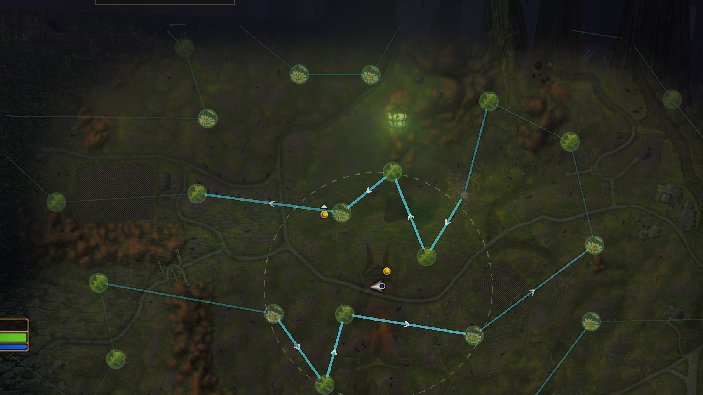
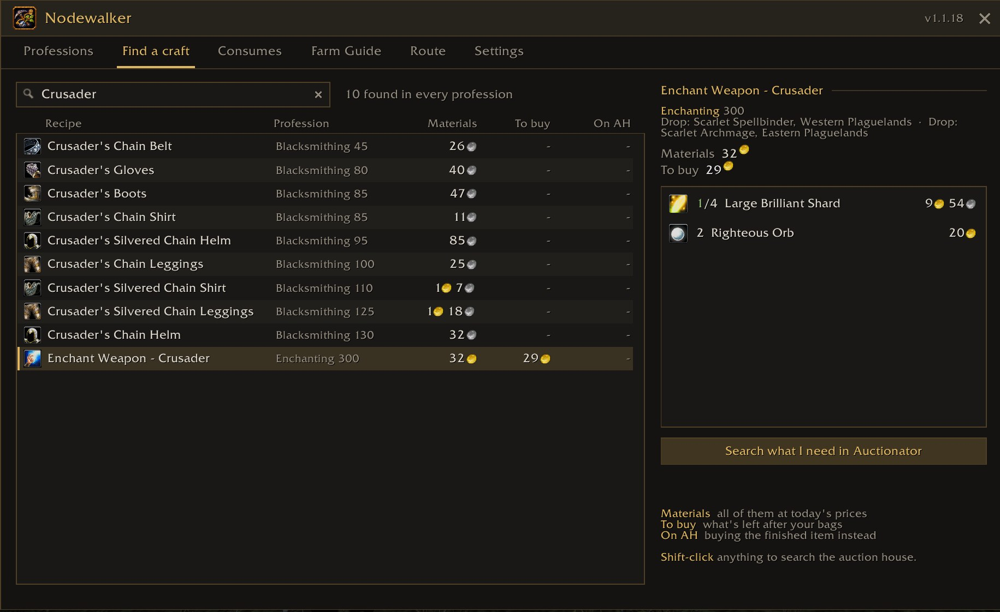

**Farming, professions and raid consumables for WoW Forever, in one addon.**

Imports your GatherMate2 nodes. Prices everything with Auctionator.

## Getting started

1. Install **GatherMate2** and **GatherMate2_Data**, and enable both.
2. Log in and type `/nw import` (or click **GatherMate2** on the Route tab). Nodewalker keeps its own copy, so you can turn GatherMate2 off afterwards.
3. Install **Auctionator** for live prices.

## Farming overlay

- A Diablo-style map in the middle of your screen
- Every known herb and ore spot, plus live dots from your minimap: confirmed spots light up
- Your route drawn on top, brightest where you are
- Click-through, fades while you move, hides in combat and cities
- Session panel: what you've gathered, loops and value

## Routes

- Builds a short loop that passes within sight of every node
- Draw avoid zones on a large, fully explored map: routes go round them
- There and back when a loop can't close

## Farm Guide

- Best zones for every herb and ore, side by side: spots, loop time, spots per minute, gold per hour
- Sort by any of them; one click builds the route
- **Both** view for Herbalism + Mining

## Leveling

- The way to 300 for every profession, at today's prices: cheapest, fewest crafts, or only recipes you know
- Grouped by rank, with each trainer stop pinned on your map
- Shopping list in recipes, materials and vendor supplies, counting your bags
- One-click Auctionator search; craft straight from the plan

## Missing recipes

- Every recipe you don't know and where it comes from
- Filter by source: trainer, Merchant's Favor, vendors and drops
- Your faction's trainers and Favor vendor

## Profit

- What every recipe earns right now, after the auction cut
- Sort by profit, return or what your bags can make now
- Click a recipe for its materials and what each costs
- Counts disenchant value for gear

## Find a craft

- Any recipe in any profession, to have someone make it
- What the materials cost, what's left after your bags, and the AH price ready-made
- One search for just what you're missing

## Consumes

- Raid consumables for every class and spec
- **My level**: the best you can use while leveling
- Stock for a 2, 3 or 4 hour raid: have against need
- Craft or buy, side by side, with the materials you have
- One search for everything you're short of
- Saved per character

## Also

- Gathering and Fishing guides by skill range
- A Nodewalker button on your profession window
- In the game's AddOns menu; action bar button; key bindings
- Presets: Farming, Questing, Minimal

## Works with

- **GatherMate2** (optional): imports its nodes
- **Auctionator** (recommended): live prices

## Commands

`/nw` overlay · `/nw plan` routes · `/nw guide` Farm Guide · `/nw prof` professions · `/nw consumes` · `/nw options` · `/nw import` GatherMate2

## Credits

Minimap tiles and map reveal data: [OpenMap](https://github.com/openmap-world/openmap) (MIT). Recipe data: SeeMeta and One For All by Smoergi (GPL-3.0-or-later). Consumable lists follow Method's and Wowhead's WoW Forever guides.

GPL-3.0-or-later.
