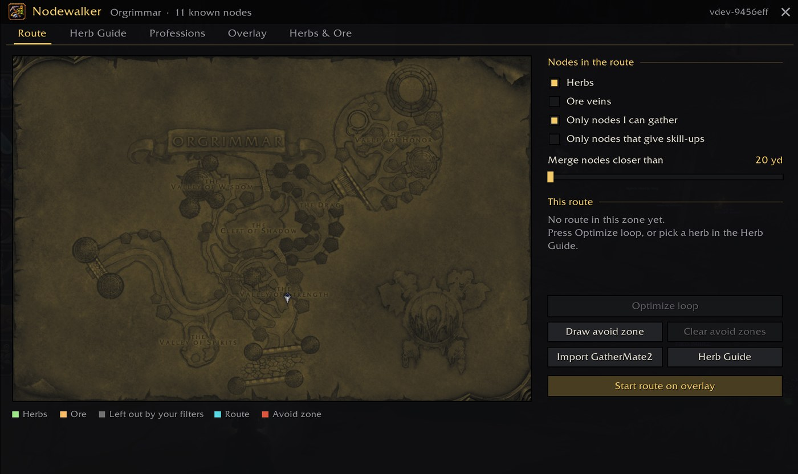
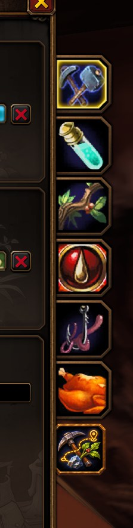
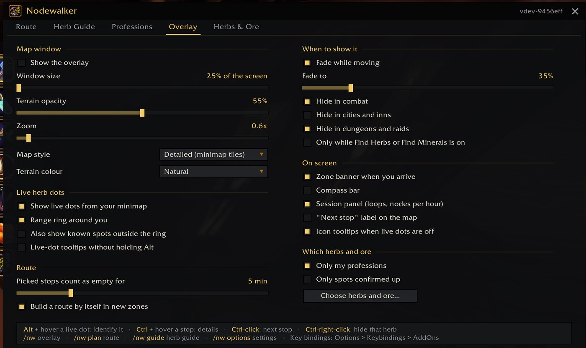
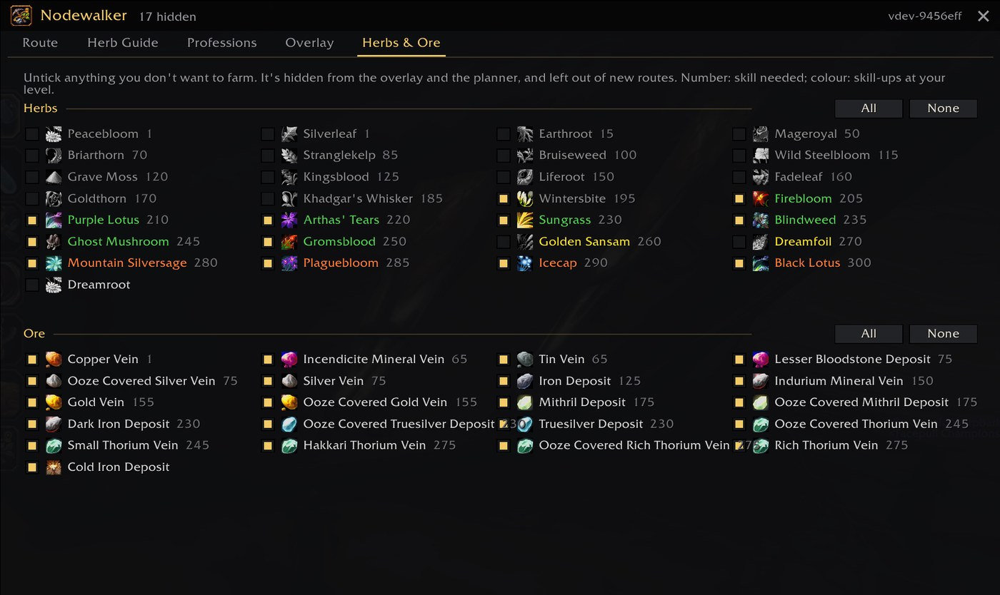

**Gathering and professions for WoW Forever, in one addon.** A Diablo-style farming map, optimized herb and ore routes, and a leveling guide for every profession, priced from the auction house.

Nodewalker replaces GatherMate2 + Routes + FarmHud for farming, and adds a profession guide on top. It **imports your GatherMate2 nodes** for routes, and **reads Auctionator's prices** so every leveling plan costs what the auction house charges today.

## Farming overlay

- A map in the middle of your screen, like Diablo II or Path of Exile. The real minimap terrain scrolls under you, caves and underground cities included.
- Live herb and ore dots from your minimap, with a ring showing how far they reach.
- Herb and ore icons for every known spot: faded until one is seen up, bright when it is.
- Clicks pass through to the world. Alt + hover a dot to see what it is.
- Only shows what your professions can gather. Hide any herb or ore you don't farm.
- Fades while moving; hides in combat, cities and dungeons.
- Zone banner as you arrive: known spots and your route.

## Routes

- **Imports GatherMate2**, including its data pack, so you start with thousands of known spots. Turn GatherMate2 off afterwards if you like.
- Builds the shortest loop through every node your filters allow, then follows it stop by stop.
- Draw avoid zones on the map to stay clear of elites and camps.
- New spots you find join the route where they add the least distance.
- Enter a zone with no route and one is built for you.
- Picked stops are skipped until they've had time to respawn.
- Session panel: loops, loop time, nodes per hour.

## Herb Guide

- The best zones for every herb, with where to look in each zone.
- Ranked by spots per minute on a loop, from your own node data.
- Preview the loop on the map, then build a route through just that herb.

## Professions

- A leveling plan for every profession, from your skill to 300: Alchemy, Blacksmithing, Enchanting, Engineering, Leatherworking, Tailoring, Cooking and First Aid.
- **Priced with Auctionator.** For each skill point it picks the cheapest recipe at today's prices, counting the chance of a skill-up as recipes turn yellow and green.
- Vendor prices are learned at merchants. Bolts, bars and parts you can make yourself are priced that way when it's cheaper.
- Uses WoW Forever's own recipes and skill-up colours, including the new ones.
- Marks when to train the next rank and which steps need a bought or found recipe.
- **Shopping list** of everything left to buy, minus what's in your bags and bank. One button searches it all in Auctionator.
- **Recipes I'm missing**: every recipe you don't know yet, and where it comes from (trainer, Merchant's Favor vendors, drops).
- Search box for recipes, materials and zones.

### Gathering and Fishing

- Where to go at every skill range for Herbalism, Mining, Skinning and Fishing.
- Mining: one click builds an ore route in the zone where you know the most veins.
- Fishing + Cooking: what to catch at your skill, and which recipes cook it.

### On the profession window

- A Nodewalker button under your professions opens the plan for the one you're in.
- Your next step along the bottom: what to craft and how many.

## Settings

- Window size, opacity, zoom, map style and terrain colour.
- When the overlay shows, what's on screen, and which herbs and ore to include.

## Works with

- **GatherMate2** (optional): imports its nodes and data pack for routes and the Herb Guide.
- **Auctionator** (optional, recommended): live prices for leveling plans and the shopping list. Rescan the auction house to update.

Without them Nodewalker still records every node you gather, and prices plans from vendors and estimates.

## Commands

- `/nw` overlay on or off
- `/nw plan` route planner
- `/nw guide` Herb Guide
- `/nw prof` profession leveling
- `/nw options` settings
- `/nw import` import GatherMate2
- `/nw next` skip to the next stop
- `/nw hide <herb>`, `/nw show <herb>`

Key bindings under Options > Keybindings > AddOns > Nodewalker.

## Credits

Minimap tile data from [OpenMap](https://github.com/openmap-world/openmap) (MIT). Recipe data from SeeMeta's WoW Forever recipe database.
