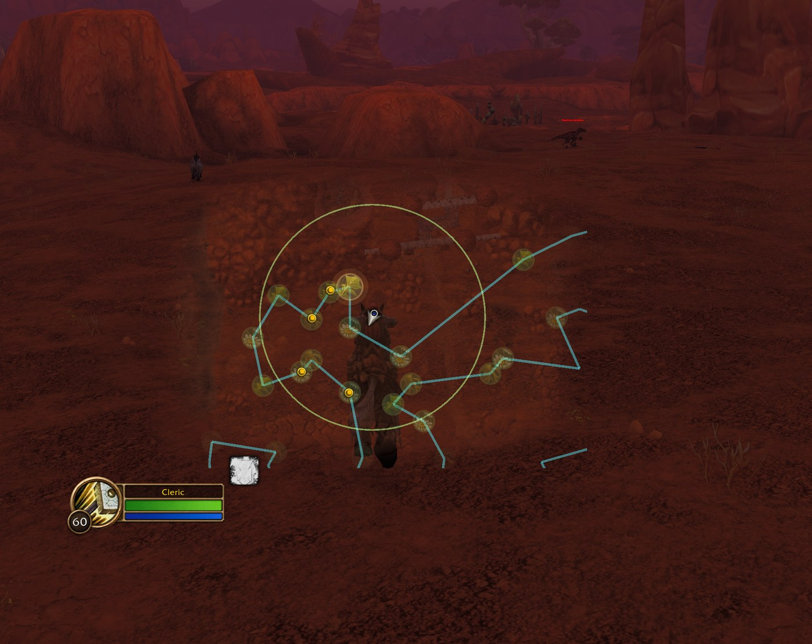

# Nodewalker

**Farm smarter. Craft cheaper. Earn more.**

A profession and gathering companion for WoW Forever: gathering routes on a Diablo-style map overlay, profession leveling plans priced from the auction house, missing recipes and where they come from, crafting profit, Fishing and Cooking together, and consumables for every class.

- CurseForge: <https://www.curseforge.com/wow/addons/nodewalker>
- [Quick start](QUICK_START.md) · [FAQ](FAQ.md) · [Changelog](CHANGELOG.md)
- Bugs and ideas: [GitHub issues](https://github.com/Vx1125/Nodewalker/issues)

## Install

Install from CurseForge, or copy the `Nodewalker` folder into `World of Warcraft\_forever_\Interface\AddOns`.

| | Addon | What it adds | Without it |
|---|---|---|---|
| Required | none | | |
| Recommended | Auctionator | Auction prices everywhere; the Search buttons | Vendor prices; the rest estimated (~) or "No price" |
| Optional | GatherMate2 + GatherMate2_Data | One-time import of known spots (`/nw import`) | Nodewalker learns spots as you gather |

Client: WoW Forever (interface 16001).

## Commands

| Command | Opens |
|---|---|
| `/nw` | Overlay on or off |
| `/nw plan` | Routes (in Material Finder) |
| `/nw guide` | Material Finder |
| `/nw prof` | Professions |
| `/nw consumes` | Consumes |
| `/nw journal` | Fishing Journal |
| `/nw fishhud` | Fishing HUD on or off |
| `/nw buffs` | Consumable tracker on or off |
| `/nw buffs debug` · `/nw buffs auras` | What the tracker reads, and every buff on you with its spell ID |
| `/nw options` | Settings |
| `/nw import` | Import GatherMate2 spots |
| `/nw import help` | The GatherMate2 import steps |
| `/nw status` | Spots and route in this zone |
| `/nw reset session` | Restart the session panel |
| `/nw next` | Skip the route's next stop |
| `/nw hide <herb>` · `/nw show <herb>` · `/nw hidden` | Hide or show one herb or vein |

`/nodewalker` works the same as `/nw`. Key bindings: Toggle overlay, Toggle route planner, Skip to next stop, Smart Fishing, Toggle fishing HUD, Fishing Journal. Smart Fishing can also be set in Settings › Fishing.

## How Consumes chooses

- **Activity: Leveling** builds a list for your level: the best of each kind (food, elixirs, potions, oils and stones, scrolls, bandages by First Aid skill) you can use now, from items in the game whose recipe you can reach at your level. It moves up as you level; the next one and the level it unlocks at are in the row's tooltip.
- **Activity: Raiding** is your spec's level-60 list, from the guides credited below.
- Both lists are in categories (Food, Elixirs, Weapon, Potions, Bandages, Utility, Situational, Camp), and each row has a tier. **Core** rows start ticked; **optional** and **situational** ones only count once you tick them. Leveling: core is your role's main list, optional its second list. Raiding: long buffs (flask, elixirs, food, weapon) are core, plus mana potions for healers; other potions, runes and on-use items optional, protection potions situational.
- Healers level by questing, so a healing spec's leveling list is its class's solo list (paladins melee, the others caster), with the healing elixir and potion as optional.
- Bandages follow your First Aid skill, not your level.
- **Strategy: Best** takes the strongest; among equals, one in your bags, else the cheapest. **Budget** uses the raid budget list; when leveling, the cheapest priced one within 10 levels of yours (50 First Aid skill for bandages), or one you carry there. **Use what I own** puts what's in your bags first: on the leveling list it shows those items; on a raid list it picks and ticks them.
- Your own picks and hand-set targets always stay. On the leveling list they follow the kind (your choice for "Elixir: agility" carries over to the next agility elixir).
- **Loadouts** save your spec, activity, strategy, stock, choices and targets per character. A leveling loadout adapts as you level (choices follow each kind); a raid loadout keeps the exact items.
- An item with no price suggests a priced one of the same kind; the list itself keeps the stronger one.
- Stock is an estimate: buffs by the duration the game gives, other items at a rough rate an hour. Deaths aren't counted. No item stats or rankings are invented.

## Consumable tracker

Settings › Consumes (or `/nw buffs`) turns on a small HUD of the consumables in your Consumes loadout: it follows your spec, level, activity, strategy, loadout and your own picks. Each icon shows what's on you and for how long, how many you carry, and a coloured edge when it's expiring (gold) or missing while you carry one (red); one you've run out of is faded. Potions, runes and bandages get their own optional row with their cooldowns; they're never "missing". Click an icon to use the item; right-click opens it in Consumes.

Buffs are recognised by spell ID: the item's own use spell from the game, or the buff Nodewalker saw you get when you used it (food's Well Fed, weapon enchants). One it hasn't confirmed yet shows as unknown, never as missing. In combat the game hides your buffs from addons, so the tracker counts down what it saw before the pull.

## Credits

Minimap tile tables in `OpenMapData/` come from [OpenMap](https://github.com/openmap-world/openmap) (MIT, see `LICENSES/`).
Smelting (Mining) levels: SeeMeta's WoW Forever recipe database, pending replacement.
The recipe lists, sources and trainer fees are generated from [OneForAll – Forever](https://www.curseforge.com/wow/addons/oneforall-forever) 6.3.0 by Smoergi (GPL-3.0-or-later, see `LICENSES/OneForAll.txt`).
Consumable lists follow Method's and Wowhead's WoW Forever class guides.

## License

GPL-3.0-or-later. See `LICENSE`.

